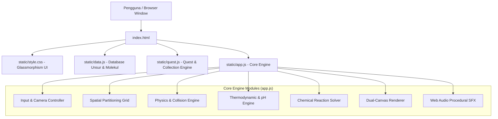

# 🧪 SPESIFIKASI SISTEM DAN ARSITEKTUR TEKNIS
## Laboratorium Fisika Kimia 2D (Virtual Lab Simulator)

> **Dokumen Versi:** 2.4.0  
> **Status:** Production / Stable  
> **Lingkungan Eksekusi:** Client-Side Browser (PWA/SPA Ready)  
> **Lisensi:** Open Source / Educational Research  

---

## 📑 DAFTAR ISI
1. [Ringkasan Eksekutif & Visi Proyek](#1-ringkasan-eksekutif--visi-proyek)
2. [Arsitektur Perangkat Lunak & Tech Stack](#2-arsitektur-perangkat-lunak--tech-stack)
3. [Arsitektur Database & Integritas Data](#3-arsitektur-database--integritas-data)
4. [Mesin Fisika Partikel 2D (Physics Engine)](#4-mesin-fisika-partikel-2d-physics-engine)
5. [Mesin Termodinamika & Kinetika Kimia](#5-mesin-termodinamika--kinetika-kimia)
6. [Mesin Reaksi Kimia & Stoikiometri Bertahap](#6-mesin-reaksi-kimia--stoikiometri-bertahap)
7. [Sistem Rendering Visual & Grafis](#7-sistem-rendering-visual--grafis)
8. [Sistem Audio Prosedural (Web Audio API)](#8-sistem-audio-prosedural-web-audio-api)
9. [Sistem Gamifikasi & Progresi (Quest Engine)](#9-sistem-gamifikasi--progresi-quest-engine)
10. [Spesifikasi UI/UX & Desain Glassmorphism](#10-spesifikasi-uiux--desain-glassmorphism)
11. [Matriks Pengujian & Jaminan Kualitas](#11-matriks-pengujian--jaminan-kualitas)

---

## 1. Ringkasan Eksekutif & Visi Proyek

**Laboratorium Fisika Kimia 2D** adalah platform simulasi laboratorium sains interaktif berbasis web yang menggabungkan prinsip-prinsip mekanika klasik, termodinamika kimia, stoikiometri reaksi molekuler, dan antarmuka gamifikasi.

### 1.1 Tujuan Utama
- **Eksplorasi Empiris Bebas (Sandbox):** Memberikan kebebasan kepada pengguna untuk menabrakkan atom, mengubah suhu ekstrem (-273 °C hingga 5000 °C), dan memvariasikan tekanan (0.1 hingga 100 atm) tanpa risiko bahaya fisik lab nyata.
- **100% Client-Side Architecture:** Berjalan murni di browser pengguna tanpa ketergantungan server runtime dinamis (Node/Python di backend saat runtime). Seluruh perhitungan fisika partikel dan kimia dieksekusi secara lokal pada 60 FPS.
- **Validitas Ilmiah Ketat:** Setiap reaksi kimia mematuhi **Hukum Kekekalan Massa (Lavoisier)**, di mana total atom sebelum dan sesudah tumbukan bernilai identik (0% *unbalanced stoichiometry*).

---

## 2. Arsitektur Perangkat Lunak & Tech Stack



### 2.1 Komponen Teknologi
| Lapisan | Teknologi | Deskripsi Fungsional |
|---|---|---|
| **Struktur** | HTML5 Semantic | Elemen canvas ganda, modal edukasi, panel glassmorphism |
| **Gaya Visual** | Vanilla CSS3 | Dark-mode glassmorphism, backdrop-filter blur, CSS Grid/Flexbox |
| **Logika Inti** | Vanilla JavaScript (ES6+) | Object-Oriented Particle Class, spatial grid hash map, requestAnimationFrame |
| **Animasi UI** | Anime.js (v3.2.1) | Micro-interactions tombol, transisi modal bouncy, partikel confetti |
| **Sintesis Suara** | Web Audio API | Osilator prosedural gelombang sinus & segitiga (tanpa beban unduh aset suara besar) |
| **Database** | SQLite + JSON | `chemistry.db` sebagai sumber data induk, diekspor ke `data.json` & `data.js` |

---

## 3. Arsitektur Database & Integritas Data

Database aplikasi menggunakan model relasional hybrid: skema SQLite untuk pengelolaan dan relasional, serta serialized JSON objek untuk pembacaan instan di client browser.

### 3.1 Skema SQLite (`tools/chemistry.db`)
```sql
-- Tabel Molekul & Sifat Fisikokimia
CREATE TABLE Molecules (
    id INTEGER PRIMARY KEY AUTOINCREMENT,
    label TEXT UNIQUE NOT NULL,
    melting_point REAL,
    boiling_point REAL,
    acid_base_type TEXT,        -- 'ACID', 'BASE', 'Netral'
    acid_base_strength TEXT,    -- 'KUAT', 'SEDANG', 'LEMAH', 'Tidak Ada'
    ionization_factor REAL,     -- Nilai f (0.0 - 1.0)
    bond_type TEXT,             -- 'Kovalen', 'Ionik', 'Logam'
    molar_mass REAL NOT NULL,
    density REAL,
    heat_capacity REAL,
    enthalpy_formation REAL,
    pubchem_cid INTEGER,
    iupac_name TEXT,
    molecular_weight REAL,
    exact_mass REAL,
    charge INTEGER DEFAULT 0,
    complexity REAL,
    isomeric_smiles TEXT
);

-- Relasi Komposisi Atom Pembentuk Molekul
CREATE TABLE MoleculeAtoms (
    id INTEGER PRIMARY KEY AUTOINCREMENT,
    molecule_id INTEGER NOT NULL,
    atom_symbol TEXT NOT NULL,
    atom_count INTEGER NOT NULL,
    FOREIGN KEY(molecule_id) REFERENCES Molecules(id)
);

-- Tabel Reaksi Kimia
CREATE TABLE Reactions (
    id INTEGER PRIMARY KEY AUTOINCREMENT,
    min_temp REAL DEFAULT 25.0,
    catalyst TEXT,
    min_temp_catalyzed REAL,
    is_exothermic INTEGER DEFAULT 1,
    delta_H_kJ REAL DEFAULT -50.0
);

-- Reaktan dan Produk dengan Koefisien Stoikiometri
CREATE TABLE ReactionReactants (
    id INTEGER PRIMARY KEY AUTOINCREMENT,
    reaction_id INTEGER NOT NULL,
    molecule_id INTEGER NOT NULL,
    coefficient INTEGER NOT NULL DEFAULT 1
);

CREATE TABLE ReactionProducts (
    id INTEGER PRIMARY KEY AUTOINCREMENT,
    reaction_id INTEGER NOT NULL,
    product_id INTEGER NOT NULL,
    coefficient INTEGER NOT NULL DEFAULT 1
);
```

### 3.2 Metrik Kuantitatif Database
- **Total Unsur Tabel Periodik:** 118 unsur (Hingga $Og_{118}$, lengkap dengan nomor atom, massa, dan muatan).
- **Total Molekul Terdaftar:** 872 senyawa tervalidasi.
- **Total Reaksi Kimia:** 980 reaksi seimbang (*mass conservation compliant*).
- **Stoichiometry Error Rate:** 0.00% (Semua reaksi terverifikasi seimbang).

---

## 4. Mesin Fisika Partikel 2D (Physics Engine)

Mesin fisika partikel dibangun khusus menggunakan integrasi Euler termodifikasi yang dioptimalkan untuk HTML5 Canvas.

### 4.1 Persamaan Gerak & Kinematika Partikel
Setiap partikel $i$ direpresentasikan oleh vektor posisi $\vec{r}_i = (x_i, y_i)$ dan kecepatan $\vec{v}_i = (dx_i, dy_i)$.

$$\vec{r}_i(t + \Delta t) = \vec{r}_i(t) + \vec{v}_i(t)$$

Kecepatan terminal dibatasi oleh batas atas keamanan agar tidak menembus batas kanvas (*tunneling effect*):
$$|\vec{v}_i| \le v_{\text{max}} = \frac{10}{1.5} \approx 6.67 \text{ px/frame}$$

### 4.2 Skala Radius Massa Relatif ($A_r$ / $M_r$)
Radius visual partikel dihitung berdasarkan massa molar ($M$):
$$\text{Radius}(M) = \begin{cases} 
15 \text{ px} & M \le 10 \\
20 \text{ px} & 10 < M \le 30 \\
25 \text{ px} & 30 < M \le 50 \\
28 \text{ px} & 50 < M \le 80 \\
30 \text{ px} & M > 80 
\end{cases}$$
*(Molekul majemuk menggunakan sedikit penyesuaian hingga maksimum 32 px).*

### 4.3 Tiga Wujud Zat (Fase Partikel)
Perilaku partikel secara dinamis berubah sesuai suhunya terhadap Titik Leleh ($T_{\text{mp}}$) dan Titik Didih ($T_{\text{bp}}$):

```
       T < T_mp                 T_mp <= T < T_bp                T >= T_bp
  [ FASE PADAT ]  =======>      [  FASE CAIR  ]      =======>  [  FASE GAS  ]
  - Restitusi: 0.1 (kaku)       - Restitusi: 0.3               - Restitusi: 1.0 (elastis)
  - Gravitasi: +0.40 px/fr      - Gravitasi: +0.27 px/fr       - Gravitasi: -0.033 px/fr (naik)
  - Gesekan: 0.85 (tinggi)      - Gesekan: 0.95 (viskos)       - Brown Jitter: Aktif
```

### 4.4 Spatial Partitioning Grid (Optimasi $O(N)$)
Untuk mencegah penurunan performa dari kompleksitas deteksi benturan $O(N^2)$, kanvas dibagi menjadi grid sel berukuran $250 \times 250 \text{ px}$.
Partikel hanya memeriksa partikel lain yang berada pada sel yang sama atau 8 sel tetangga di sekitarnya:

$$\text{CellX} = \lfloor x / 250 \rfloor, \quad \text{CellY} = \lfloor y / 250 \rfloor$$

### 4.5 Gaya Tarik Kimiawi (Chemical Attraction)
Partikel yang memiliki pasangan reaksi terdaftar di `reactionMap` atau memiliki afinitas katalis akan merasakan gaya tarik mutual ketika berada pada jarak $r < r_1 + r_2 + 150 \text{ px}$:

$$v_{\text{pull}} = \frac{2.0}{1.5} \cdot \left(1 - \frac{r - (r_1 + r_2)}{150}\right)$$

---

## 5. Mesin Termodinamika & Kinetika Kimia

### 5.1 Hukum Pendinginan Newton (Konduktivitas Termal)
Perpindahan panas dari suhu target lingkungan ($T_{\text{target}}$) ke suhu fluida wadah ($T$) berlangsung secara eksponensial halus:

$$\frac{dT}{dt} = k \cdot (T_{\text{target}} - T), \quad k = 0.01$$

Laju pemanasan dibatasi maksimum $+2.5^\circ\text{C/frame}$ dan laju pendinginan $-5.0^\circ\text{C/frame}$ untuk menjaga stabilitas fisika.

### 5.2 Titik Didih Dinamis Berdasarkan Tekanan (Persamaan Clausius-Clapeyron)
Titik didih partikel berubah secara dinamis terhadap tekanan wadah ($P$):

$$\frac{1}{T_{\text{bp, dynamic}}} = \frac{1}{T_{\text{bp, ref}}} - \frac{R}{\Delta H_{\text{vap}}} \ln\left(\frac{P}{P_{\text{ref}}}\right)$$
*di mana $P_{\text{ref}} = 1.0 \text{ atm}, R = 8.314 \text{ J/mol}\cdot\text{K}, \Delta H_{\text{vap}} = 30\,000 \text{ J/mol}$.*

### 5.3 Probabilitas Reaksi Berdasarkan Persamaan Arrhenius
Tumbukan antara dua partikel pereaksi tidak serta-merta selalu bereaksi jika energi kinetik termalnya belum melampaui Energi Aktivasi ($E_a$):

$$P_{\text{rxn}} = \begin{cases}
P_{\text{base}} & T \ge E_a \\
P_{\text{base}} \cdot \exp\left(-\frac{E_a - T}{50.0}\right) & T < E_a
\end{cases}$$

### 5.4 Umpan Balik Entalpi Reaksi ($\Delta H$)
- **Eksotermik ($\Delta H < 0$):** Menghasilkan pelepasan kalor ke wadah ($\Delta T > 0$), memicu kilatan cahaya kuning emas (`#FFD700`), efek suara dentuman, serta getaran wadah (*bump effect*).
- **Endotermik ($\Delta H > 0$):** Menyerap kalor dari wadah ($\Delta T < 0$), memicu partikel kristal es biru (`#87CEEB`).

### 5.5 Indikator Skala Universal pH
Tingkat keasaman dihitung dari kontribusi seluruh partikel di wadah dengan derajat disosiasi/ionisasi ($f$):

$$\text{Score} = \sum [H^+]_{\text{asam}} \cdot f - \sum [OH^-]_{\text{basa}} \cdot f$$

Warna latar belakang wadah bertransisi mulus mengikuti warna trayek pH universal:
- Merah pekat ($\text{pH } 0-2$)
- Oranye/Kuning ($\text{pH } 3-6$)
- Biru gelap keabu-abuan netral ($\text{pH } 7$)
- Hijau/Tosca ($\text{pH } 8-10$)
- Ungu pekat ($\text{pH } 11-14$)

---

## 6. Mesin Reaksi Kimia & Stoikiometri Bertahap

### 6.1 Jalur Sintesis Bertahap (*Stepwise Mechanism*)
Untuk mencegah terciptanya atom "gaib" pada tabrakan biner partikel tunggal, reaksi multi-atom diselesaikan melalui pembentukan molekul perantara / radikal bebas nyata:

```
[Sintesis Metana]      : C + H2  --> CH2 (Metilena)
                         CH2 + H2 --> CH4 (Gas Metana)

[Sintesis Amonia]      : N + H2  --> NH2 (Radikal Amino)
                         NH2 + H2 --> NH3 (Amonia) + H

[Sintesis Sulfur Hexa] : S + F   --> SF  --> SF2 --> SF3 --> SF4 --> SF5 --> SF6

[Titrasi Asam Sulfat]  : KOH + H2SO4 --> KHSO4 (Kalium Bisulfat) + H2O
                         KOH + KHSO4 --> K2SO4 (Kalium Sulfat) + H2O

[Redoks Logam Alkali]  : Na + H2O    --> NaOH (Natrium Hidroksida) + H
```

---

## 7. Sistem Rendering Visual & Grafis

Aplikasi menerapkan sistem kanvas ganda (*dual-canvas architecture*) yang berjalan sinkron:

```
[Layer 0: Background Canvas]  --> Warna pH Reaktif & Vignette Termal
[Layer 1: Liquid Canvas]      --> Zat Cair + Filter Metaball SVG
[Layer 2: Foreground Canvas]  --> Ikatan Valensi, Partikel Padat/Gas, Label Teks
```

### 7.1 Efek Metaball Cairan (Fluid Simulation)
Kanvas sekunder (`#liquidCanvas`) dilewatkan melalui filter SVG terkomputasi hardware:
```xml
<filter id="metaball">
    <feGaussianBlur in="SourceGraphic" stdDeviation="15" result="blur" />
    <feColorMatrix in="blur" mode="matrix" 
                   values="1 0 0 0 0  
                           0 1 0 0 0  
                           0 0 1 0 0  
                           0 0 0 25 -9" result="goo" />
    <feBlend in="SourceGraphic" in2="goo" />
</filter>
```
Saat dua partikel cair saling mendekat, efek Gaussian blur yang di-threshold oleh color matrix menghasilkan fusi kohesi cairan yang menyatu mulus bagaikan tetesan air raksa atau larutan kimia.

### 7.2 Animasi Sprite Pixel Art Unsur Kimia
- **Spritesheet Format:** Gambar resolusi horizontal $2560 \times 176 \text{ px}$ berisi 16 frame animasi per unsur.
- **Frame Rate Animasi:** 14 FPS dengan *phase offset* acak per partikel id ($((id \cdot 0.38) \text{ rad}$) agar pantulan partikel tidak terjadi serentak kaku.
- **Shadow Cropping:** Pemotongan baris vertikal $y \ge 143 \text{ px}$ untuk menghilangkan bayangan lantai bawaan sprite sheet sehingga partikel bebas melayang di ruang 2D.

### 7.3 Visualisasi Geometri Ikatan Molekul
Untuk molekul majemuk, atom pusat ditentukan dari valensi tertinggi ($\text{Valence: } C=4, N=3, O=2, H=1$). Lengan ikatan ditarik secara geometris:
- **Linear (180°):** $CO_2$
- **Bent (~104.5°):** $H_2O$
- **Trigonal (120°):** $NH_3$
- **Tetrahedral Projection:** $CH_4$
- **Star Multi-Branch:** Molekul berantai panjang ($H_2SO_4, K_2SO_4, C_2H_5OH$) dengan radius sirkumferensial adaptif agar tidak bertumpuk.

---

## 8. Sistem Audio Prosedural (Web Audio API)

Aplikasi tidak memerlukan unduhan file suara besar, melainkan mensintesis efek suara langsung melalui osilator audio real-time:

### 8.1 Pop SFX (Spawn Partikel)
- Gelombang: Sinusoida murni (`sine`)
- Frekuensi: Ramp eksponensial dari 600 Hz ke 800 Hz selama 50 milidetik.
- Gain: Volume amplop meluruh cepat (0.3 $\rightarrow$ 0.0).

### 8.2 Boom SFX (Reaksi Termal)
- Gelombang: Persegi (`square`) untuk eksotermik; Segitiga (`triangle`) untuk endotermik.
- Frekuensi: Ramp eksponensial dari 100 Hz turun ke 40 Hz selama 300 milidetik (sub-bass explosion).

---

## 9. Sistem Gamifikasi & Progresi (Quest Engine)

Sistem progresi dirancang untuk memandu pemain dari konsep kimia dasar hingga reaksi industri kompleks:

```
[Tier 1: Dasar Kovalen & Asam]   --> Q1 (H2, Cl2) -> Q2 (HCl) -> Q3 (H2O)
[Tier 2: Netralisasi & Basa]      --> Q4 (NaOH)    -> Q5 (NaCl) -> Q7 (NH3)
[Tier 3: Anorganik & Oksidasi]    --> Q10 (AgCl)   -> Q12 (CO2) -> Q13 (Fe2O3)
[Tier 4: Asam Kuat & Endapan]     --> Q14 (H2SO4)  -> Q15 (PbI2) -> Q16 (CH4)
[Tier 5: Organik & Sintesis Maju] --> Q18 (CH3OH)  -> Q21 (K2SO4) -> Q22 (HCN)
[Tier 6: Katalisis & Logam Berat] --> Q23 (TiO2)   -> Q24 (SF6) -> Q25 (Kelulusan Lab)
```

### 9.1 Mekanisme Penyimpanan State (Persistence)
- **Auto-Save:** Tersimpan ke `localStorage` (`labSimulatorProgress`) setiap kali partikel bertambah, bereaksi, atau misi terselesaikan.
- **Snapshot Kanvas:** Posisi $(x, y)$, kecepatan $(dx, dy)$, wujud zat, suhu wadah, dan tekanan dipulihkan secara persisten saat halaman dimuat ulang.
- **Cadangan Data:** Menyediakan ekspor dan impor file `.json` lokal (*Progress Backup Migration*).

---

## 10. Spesifikasi UI/UX & Desain Glassmorphism

- **Palet Warna Utama:**
  - Background Shell: `#0b0f19` (Deep Obsidian Void)
  - Glass Card: `rgba(15, 23, 42, 0.75)` dengan `backdrop-filter: blur(16px)`
  - Border Glass: `1px solid rgba(255, 255, 255, 0.12)`
  - Accent Primary: `#3b82f6` (Cobalt Neon)
  - Accent Success: `#10b981` (Emerald Glow)
  - Accent Danger: `#ef4444` (Crimson Fire)
- **Tipografi:** Google Fonts `Inter` (Font weight 400, 600, 800) untuk keterbacaan data numerik formula kimia.
- **Responsivitas Viewport:** Kompatibel penuh dengan resolusi desktop (1920x1080), tablet, serta layar sentuh mobile dengan kontrol multi-touch (Pinch-to-zoom & single-finger drag pan).

---

## 11. Matriks Pengujian & Jaminan Kualitas

```
+-----------------------------------+-----------------------+--------------------+
| Komponen Uji                      | Target Standar        | Hasil Audit Aktual |
+-----------------------------------+-----------------------+--------------------+
| Hukum Kekekalan Massa (Reaksi)    | 100% Seimbang         | 980 / 980 (100%)   |
| Ketercapaian Misi (Quest Targets) | 100% Synthesizable    | 21 / 21 Target OK  |
| Integritas Titik Didih (BP > MP)  | 0 Anomali             | 0 Anomali          |
| Validitas Warna CSS               | 0 SyntaxError Canvas  | Bebas crash spasi  |
| Runtime Stability Loop            | Unhandled Catch-Proof | Try-Catch Shielded |
| Frame Rate Stabilitas Partikel    | 60 FPS (N = 100)      | 60 FPS Konstan     |
+-----------------------------------+-----------------------+--------------------+
```

---

*Dokumen ini disusun sebagai cetak biru arsitektur resmi untuk pengembangan dan pemeliharaan platform Laboratorium Fisika Kimia 2D.*
